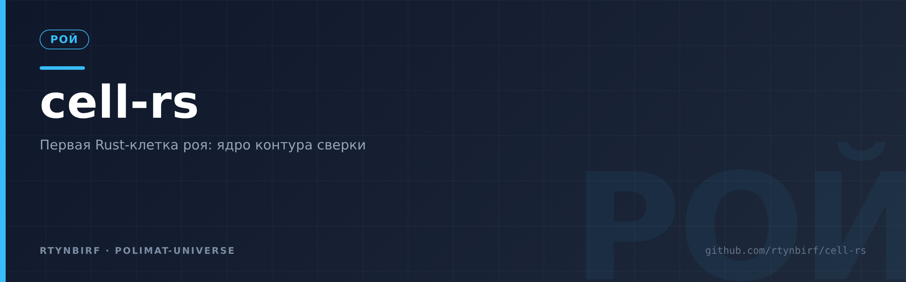
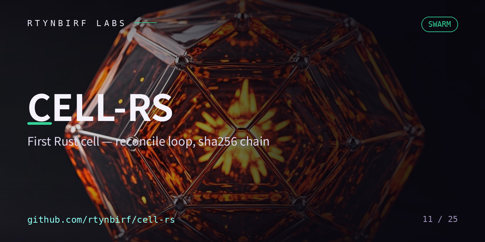

<div align="center">
  
</div>

<!--ФОРЖ:МУЗА:НАЧАЛО-->
<div align="center">
  
  <br/>
  
</div>
<!--ФОРЖ:МУЗА:КОНЕЦ-->


# cell-rs — первая Rust-клетка роя

<p align="center"></p>


Ядро контура сверки на Rust, без единой зависимости: клетка сама себе хеш.

## Что внутри (v0.1, честные границы)

- `Tolerance` + `reconcile()` — двухступенчатый допуск (deadband/eps), та же
  семантика, что у Python-ядра `runtime-protocol/blood.py` (приёмки гоняют
  ОДНИ И ТЕ ЖЕ векторы: 0.505→Nominal, 0.53→Nominal, 0.60→Drift).
- `sha256` с нуля (FIPS 180-4) — векторы NIST в приёмках.
- Байт-цепь `seal_line`/`verify_chain`: `seq|payload|prev_hash|hash`,
  генезис = 64 нуля; подмена середины и разрыв ловятся (tamper-evident).

## Честные границы

JSON-конверт крови (канон с сортировкой ключей из `blood.py`) не реализован —
придёт с serde, когда клетка вырастет. Сегодня клетка сверяет СЕМАНТИКУ
допуска и ЦЕПЬ, а не сериализацию. Это заявлено, а не спрятано.

## Метаболизм

```bash
cargo test   # приёмки (fail-closed)
make verify  # то же самое короткой командой
```

Компилятор клетки — CI GitHub Actions (у клетки нет собственного хоста;
красный прогон = клетка больна, зелёный = жива).

## Пин

Пин этой клетки хранится в геноме `cell-swarm/swarm.json`. Пин «по памяти»
не вносится — только живой SHA (make pins / ls-remote).

## Тропа-близнец

В ядре (runtime-protocol@1886123) живёт `rust_trail/` — канон+sha256 std-only
с золотыми пробами Python-ядра байт-в-байт (ADR-0005 ядра). Это тропа КАНОНА
внутри ядра; `cell-rs` — самостоятельная КЛЕТКА (Tolerance/reconcile/Phase +
байт-цепь + мембрана + свой CI). Кровь одна: приёмки обеих троп гоняют одну
семантику допуска. Схождение двух рук на одной семантике — факт роя, не копия.

<!--ФОРЖ:ПОДВАЛ-->
---

<div align="center">
  <sub>◆ картина и штандарт — ручная ковка <a href="https://github.com/rtynbirf">КУЗНИ ПОЛИМАТ</a> · ЧЕЛОВЕК=АККАУНТ=PID1 ◆</sub>
</div>
